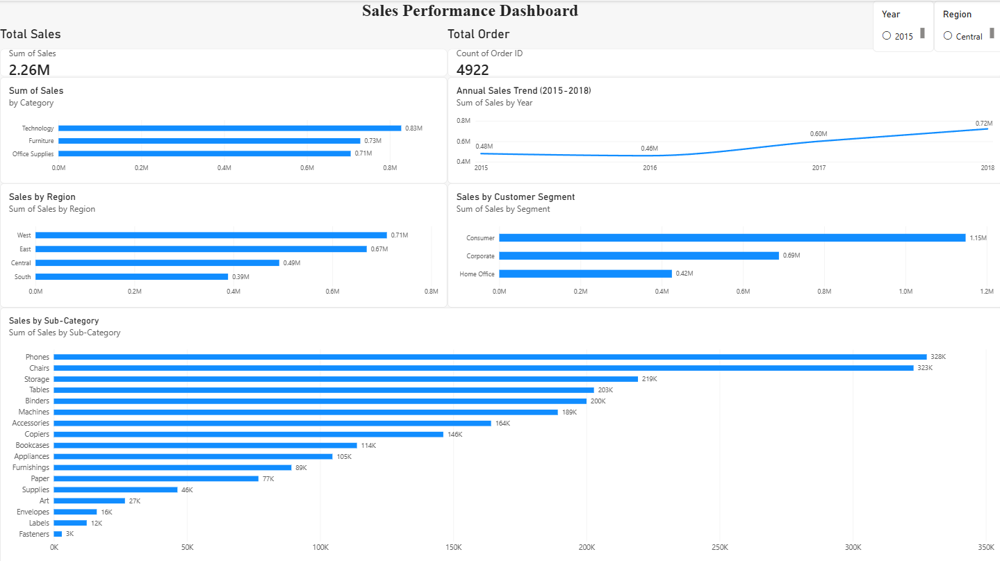

# Sales Performance Analysis

## Project Overview

This project analyzes retail sales data using Python and Power BI to identify sales trends and performance across product categories, regions, and customer segments.

## Business Objectives

* Analyze annual sales performance and year-over-year changes.
* Identify the highest-performing product categories.
* Compare sales performance across regions.
* Understand sales distribution across customer segments.
* Build an interactive dashboard to support data-driven decision-making.

## Tools

* Python (Pandas)
* Jupyter Notebook
* Power BI

## Dataset

The project uses the Superstore-style Sales Forecasting dataset.

**Source:** https://www.kaggle.com/datasets/rohitsahoo/sales-forecasting

The dataset is not included in this repository. Please obtain it from the original source.

## Key Insights

1. **Sales Growth:** Sales declined by 4.26% in 2016, then increased by 30.64% in 2017 and 20.30% in 2018.
2. **Top Category:** Technology generated the highest sales at approximately $827,455.87.
3. **Regional Performance:** The West region recorded the highest sales at approximately $710,219.68, while the South recorded the lowest at approximately $389,151.46.
4. **Business Opportunity:** The differences in sales across regions and categories could be investigated further to identify opportunities for improvement.

## Dashboard

The Power BI dashboard includes:

* Total Sales
* Total Orders
* Sales by Category
* Sales by Region
* Sales by Customer Segment
* Sales by Sub-Category
* Annual Sales Trend
* Year and Region filters

## Files

* `sales_analysis.ipynb` — Python analysis notebook.
* `Sales_Performance_Dashboard.pbix` — Interactive Power BI dashboard.

## Conclusion

This project demonstrates the use of Python for data analysis and Power BI for interactive sales reporting. The findings provide an overview of sales performance and highlight areas for further investigation.
